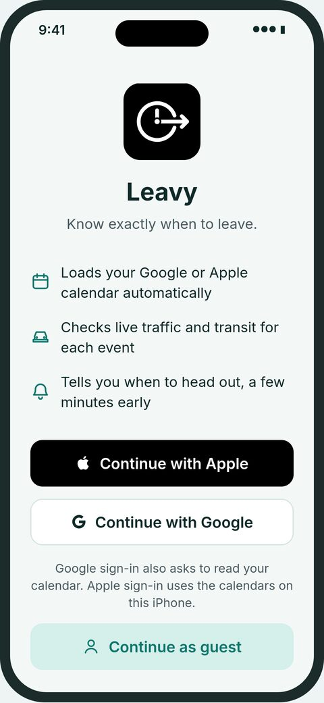
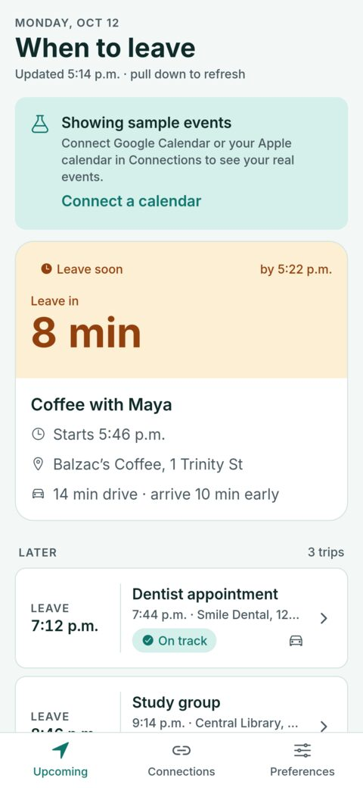
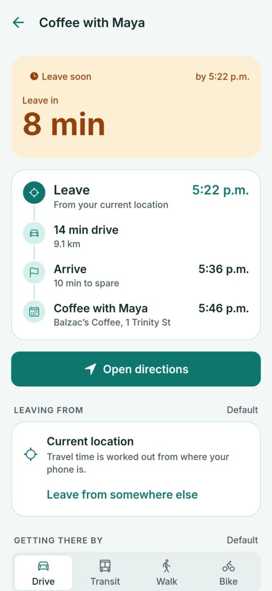
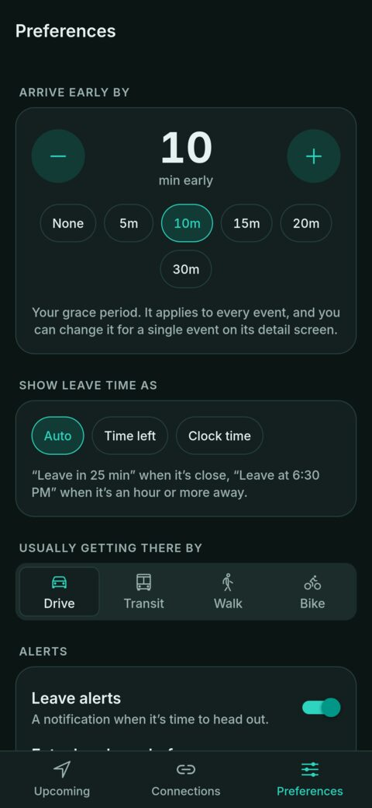

# Leavy

Leavy reads your calendar, checks live travel time with Google Maps, and tells you **when to leave** for each event. It adds a grace period so you arrive a few minutes early, and sends a notification when it's time to go.

```
leave by = event start − grace period − travel time
```

- **Calendars:** Google Calendar (with Google sign-in), the phone's calendars including iCloud, or a private iCal link.
- **Travel:** driving with live traffic, transit on real schedules, walking or cycling. Each event can have its own travel mode, grace period, alerts and start address.
- **Leave time your way:** a countdown ("Leave in 25 min") or the clock time ("Leave at 6:30 PM"). By default it switches to the clock time when departure is an hour or more away.
- **Accounts:** optional Google or Apple sign-in. Preferences sync to your account.
- **Demo mode:** sample events, so the app runs with no keys or accounts.

Built with Expo SDK 57, Expo Router, TypeScript and Supabase.

<p align="center">
  
  
  
  
</p>
<p align="center"><sub>Sign-in · Upcoming · Trip timeline · Preferences (dark mode). Screenshots use demo mode's sample events.</sub></p>

## Run it locally

You need Node.js 20+ and either a phone with [Expo Go](https://expo.dev/go) or the Android emulator.

```bash
git clone https://github.com/langchengit/leavy.git
cd leavy
npm install
cp .env.example .env.local   # leave it blank for demo mode
```

Then start it the way that fits your setup:

| Where | Command |
| --- | --- |
| Phone on the same Wi-Fi | `npx expo start --go`, then scan the QR code |
| Phone on school or work Wi-Fi | `npm run tunnel` (needs [`cloudflared`](https://developers.cloudflare.com/cloudflare-one/connections/connect-networks/downloads/)) |
| Android emulator | start the emulator, then `npm run android` |
| Browser | `npm run web` (demo UI only) |

Press **r** in the terminal to reload, and run with `--clear` once after adding or removing screens.

**Live data:** with no keys, the app shows sample events. For real travel times, add a Google Maps key to `.env.local`. For sign-in and real calendars, add the Supabase and Google keys too. [docs/SETUP.md](docs/SETUP.md) walks through each one.

**Sign-in, phone calendars and Android alerts** don't work in Expo Go. They need a development build:

```bash
npx expo run:android   # needs the Android SDK and Java 17
npx eas-cli@latest build --profile development --platform ios   # needs an Apple Developer account
```

On the emulator, set a location under **⋯ → Location**, or travel times start from Google's office in California.

## Testing a build

Testers don't need a dev environment:

1. The maintainer runs `npx eas-cli@latest build --profile preview --platform android` (or `ios`) and shares the install link.
2. On iPhone, register your device first with `npx eas-cli@latest device:create`, then the maintainer rebuilds.
3. For Google sign-in, ask to be added as a test user. Until Google reviews the app, only listed accounts can sign in.

Worth checking: leave times against Google Maps, the status changes (*On track → Leave soon → Leave now → Running late*), alert timing, and the per-event settings on an event's detail screen.

## Contributing

Contributions of any size are welcome, from fixing a typo to adding a feature. You don't need any API keys to get started: demo mode covers most of the app, so you can clone it and start changing things right away. If you're not sure where to begin or whether an idea fits, open an issue and ask.

1. Create a branch off `master`.
2. Screens go in `src/app/` (Expo Router). Components go in `src/components/`, and logic in `src/lib/`.
3. Add packages with `npx expo install <package>` so versions match the SDK.
4. Before opening a pull request, run `npm test`, `npm run lint`, and `npm run typecheck`.
5. In the pull request, say what changed and how you tested it (Expo Go, dev build, emulator or device).

Every pull request runs lint and typecheck automatically. Claude also reviews pull requests from branches in this repo; for a pull request from a fork, a maintainer can comment `@claude review this PR`.

Don't commit `.env.local`, and don't edit the generated `android/` and `ios/` folders. Native settings belong in `app.json` and `app.config.ts`.

## Known limits

- Alerts are only rescheduled when the app refreshes, so traffic changes while it's closed aren't picked up.
- Per-event settings apply to one occurrence of a recurring event.
- Without a start address, trips start from where you are now, not from your previous event.

## License

Leavy is free software, licensed under the [GNU General Public License v3.0 or later](LICENSE). You can use, study, share and change it. If you distribute a modified version, it has to be under the GPL too, with its source code available.
